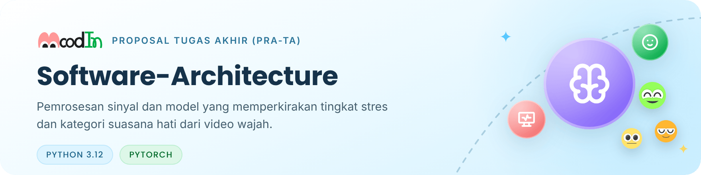

<picture>
  <source media="(prefers-color-scheme: dark)" srcset=".github/readme/banner-dark.png">
  
</picture>

<p align="center">
  <a href="#1-ruang-lingkup-tahap-pra-ta">Ruang lingkup</a> ·
  <a href="#2-struktur-repo">Struktur</a> ·
  <a href="#3-menjalankan">Menjalankan</a> ·
  <a href="#4-dataset">Dataset</a> ·
  <a href="#5-asal-kode">Asal kode</a> ·
  <a href="#6-rujukan">Rujukan</a>
</p>

Repositori ini berisi "otak" MoodIn: kode yang mengubah video wajah menjadi dua perkiraan, yaitu **tingkat stres** dan **kategori suasana hati** (_mood_). Tingkat stres diperkirakan dari sinyal denyut yang diekstraksi dari video wajah (_remote photoplethysmography_, rPPG) dan variabilitas denyut jantung (HRV). Kategori _mood_ diperkirakan dari gerak _landmark_ wajah. Inferensi berjalan lokal di NVIDIA Jetson Orin Nano Super, sedangkan pelatihan model dilakukan di GPU Kaggle atau Colab.

Repositori ini bagian dari proyek [MoodIn](https://github.com/MoodInBME/MoodIn-master), yang saat ini dikembangkan sebagai Proposal Tugas Akhir (Pra-TA). Kode antarmuka ada di [Interface-App](https://github.com/MoodInBME/Interface-App), dan skrip perangkat keras ada di [Hardware-Connections](https://github.com/MoodInBME/Hardware-Connections).

<p>
  
  
  
  
</p>

> [!NOTE]
> **Status (28 Okt 2026):** kode di repositori ini masih versi era GEMASTIK, sama dengan tag [`gemastik-xix-2026`](https://github.com/MoodInBME/Software-Architecture/tree/gemastik-xix-2026). Pengembangan tahap Pra-TA dimulai dari jalur fisiologis (milestone M1). Jalur wajah menunggu keputusan bimbingan (M4). Rincian metode ada di dokumen Proposal Tugas Akhir dan belum dipublikasikan.

## 1. Ruang lingkup tahap Pra-TA

MoodIn memakai dua jalur pemrosesan yang berjalan berdampingan. Keduanya membaca video wajah yang sama, tetapi menghasilkan keluaran yang berbeda.

<table>
  <tr>
    <td width="50%" valign="top">
      <br>
      <b>Jalur fisiologis → tingkat stres</b><br>
      Sinyal denyut diestimasi dari perubahan warna kulit wajah yang sangat halus (rPPG), lalu diturunkan menjadi denyut jantung dan fitur HRV untuk klasifikasi tingkat stres. Jalur ini dikerjakan lebih dulu (M1).
    </td>
    <td width="50%" valign="top">
      <br>
      <b>Jalur wajah → kategori <i>mood</i></b><br>
      Gerak <i>landmark</i> wajah dianalisis untuk memperkirakan salah satu dari lima kategori: Ceria, Rileks, Netral, Cemas, atau Tertekan. Rancangannya menunggu keputusan bimbingan (M4).<br>
      
      
      
      
      
    </td>
  </tr>
</table>

| Jalur      | Keluaran                | Kode yang ada sekarang                                               | Rencana                                                    |
| ---------- | ----------------------- | -------------------------------------------------------------------- | ---------------------------------------------------------- |
| Fisiologis | Tingkat stres           | `models/stc_rppg/` (STC-rPPG), pemuat UBFC-rPPG                      | M1: pemuat dataset, turunan HRV, klasifikasi tingkat stres |
| Wajah      | Kategori _mood_         | `models/st_gcn_graph_tran/` dan `data/preprocessing/` (era GEMASTIK) | M4, setelah keputusan bimbingan                            |
| Fusi       | —                       | `models/fusion/` (era GEMASTIK)                                      | Menunggu keputusan bimbingan                               |
| Komunikasi | Pesan MQTT ke antarmuka | `communication/` (kontrak v1.0.0)                                    | Mengikuti kontrak pesan v2 di MoodIn-master                |

## 2. Struktur repo

```text
Software-Architecture/
├── models/
│   ├── stc_rppg/              jalur fisiologis: STC-rPPG (model, loss, pelatihan, pascaproses)
│   ├── st_gcn_graph_tran/     jalur wajah era GEMASTIK (ST-GCN + Graph Transformer)
│   └── fusion/                fusi era GEMASTIK
├── data/
│   ├── loaders/               pemuat dataset (UBFC-rPPG, video ekspresi)
│   ├── preprocessing/         ekstraksi landmark era GEMASTIK
│   └── dataset_cards/         kartu dataset: sumber, lisensi, cara pakai
├── evaluation/                metrik valensi-arousal
├── communication/             klien MQTT dan skema pesan (kontrak v1.0.0)
├── config/default.yaml        konfigurasi inferensi
├── tests/                     uji bentuk tensor STC-rPPG dan DiTAC
├── notebooks/arsip-gemastik/  notebook pelatihan CK+ era GEMASTIK
├── docs/arsip-gemastik/       telaah kode dan rencana era GEMASTIK
├── inference.py               pipeline inferensi waktu nyata (era GEMASTIK)
├── train.py                   petunjuk pelatihan per jalur
├── generate_dummy.py          pembuat bobot dummy untuk uji jalan
├── JETSON_SETUP.md            pemasangan pustaka di Jetson
└── *.sh, diag_warmup.py       skrip diagnosis Jetson (akan dipindah ke Hardware-Connections)
```

## 3. Menjalankan

### Lingkungan di laptop

```bash
python -m venv .venv
# Windows: .venv\Scripts\activate    Linux: source .venv/bin/activate
python -m pip install -r requirements.txt
```

Alternatif dengan conda: `conda env create -f environment.yml`. Untuk Jetson, ikuti [JETSON_SETUP.md](JETSON_SETUP.md); jangan memasang `torch` dari PyPI di Jetson.

### Bobot dummy

Bobot model tidak disimpan di git. Untuk menguji jalannya `inference.py` tanpa model terlatih, buat bobot dummy dari root repo:

```bash
python generate_dummy.py
```

Perintah ini membuat `weights/dummy_stgcn.pth` dan `weights/dummy_stcrppg.pth`. Keluarannya tidak bermakna. Selama `demo_mode: true` di `config/default.yaml`, layar menampilkan penanda "MODE DEMO".

### Uji bentuk tensor

```bash
python -m tests.main
python -m tests.test_ditac
```

> [!WARNING]
> Kedua skrip masih memakai jalur impor dari sebelum reorganisasi folder (Juli 2026), sehingga perlu diperbaiki lebih dulu. Perbaikannya dijadwalkan di M1.

## 4. Dataset


Model dilatih dan diuji dengan dataset publik lebih dulu, sebelum ada data primer. Setiap dataset punya kartu yang menjelaskan sumber, lisensi, dan cara pakainya.

| Dataset   | Peran                               | Status                                | Kartu                                           |
| --------- | ----------------------------------- | ------------------------------------- | ----------------------------------------------- |
| UBFC-Phys | Jalur fisiologis tahap Pra-TA       | Tersedia                              | [ubfc-phys.md](data/dataset_cards/ubfc-phys.md) |
| PURE      | Jalur fisiologis, estimasi denyut   | Perlu permintaan akses                | [pure.md](data/dataset_cards/pure.md)           |
| UBFC-rPPG | STC-rPPG era GEMASTIK               | Tersedia                              | [ubfc-rppg.md](data/dataset_cards/ubfc-rppg.md) |
| Aff-Wild2 | Jalur wajah                         | EULA sudah diajukan; belum dibutuhkan | —                                               |
| CK+       | _Baseline_ jalur wajah era GEMASTIK | Tidak dipakai lagi                    | —                                               |

Data primer menunggu izin etik. Berkas dataset, turunannya, dan citra wajah **tidak boleh** di-commit; pola pengecualiannya ada di `.gitignore`.

## 5. Asal kode

Repo ini dimulai pada era GEMASTIK XIX 2026 oleh tim VisionaryX. Tabel berikut merangkum penulis baris kode per berkas pada tag `gemastik-xix-2026`, berdasarkan `git blame` dan dibulatkan. Riwayat lengkap ada di `git log`.

| Berkas atau folder                                                                                                   | Penulis baris (kurang lebih)                   | Rujukan metode             |
| -------------------------------------------------------------------------------------------------------------------- | ---------------------------------------------- | -------------------------- |
| `models/stc_rppg/`: `cdc.py`, `ditac.py`, `fsfe.py`, `stfe.py`, `predictor.py`, `loss.py`, `train.py`, `config.yaml` | Tanuhita Setya Dhanurendra 100%                | STC-rPPG [1]               |
| `models/stc_rppg/model.py`                                                                                           | Jeremia 58%, Tanuhita 41%                      | STC-rPPG [1]               |
| `models/stc_rppg/postprocessing.py`                                                                                  | Jeremia 100%                                   | —                          |
| `data/loaders/dataset_ubfc_loader.py`, `data/loaders/prepare_data_ubfc.py`                                           | Tanuhita sekitar 67%, Jeremia sekitar 33%      | UBFC-rPPG [4]              |
| `data/loaders/download_ubfc_kaggle.py`                                                                               | Jeremia 54%, Tanuhita 45%                      | —                          |
| `tests/main.py`, `tests/test_ditac.py`                                                                               | Tanuhita 100%                                  | —                          |
| `train.py`                                                                                                           | Jeremia 83%, Tanuhita 16%                      | —                          |
| `inference.py`                                                                                                       | Jeremia 99%; versi awal berkas dibuat Tanuhita | —                          |
| `models/st_gcn_graph_tran/`                                                                                          | Jeremia 100%                                   | ST-GCN [5], Graph-Tran [6] |
| `models/fusion/`, `data/preprocessing/`, `evaluation/`, `communication/`, `config/`, notebook, skrip Jetson, dokumen | Jeremia 100%                                   | —                          |

Nozomi Crystalle Padilla Malle dan Sitti Nurhalimah tidak menulis kode di repo ini. Isi yang dipindah saat reorganisasi folder pada Juli 2026 tetap tercatat atas nama penulis aslinya. Berkas kecil seperti `__init__.py` tidak dicantumkan.

## 6. Rujukan

1. L. Lin dkk., "STC-rPPG: A remote heart rate estimation network based on spatiotemporal–channel feature collaborative learning," _IEEE Transactions on Instrumentation and Measurement_, vol. 74, art. 4017910, 2025, doi: [10.1109/TIM.2025.3613915](https://doi.org/10.1109/TIM.2025.3613915).
2. R. Meziati Sabour, Y. Benezeth, P. De Oliveira, J. Chappé, dan F. Yang, "UBFC-Phys: A multimodal database for psychophysiological studies of social stress," _IEEE Transactions on Affective Computing_, vol. 14, no. 1, hal. 622–636, 2023, doi: [10.1109/TAFFC.2021.3056960](https://doi.org/10.1109/TAFFC.2021.3056960).
3. R. Stricker, S. Müller, dan H.-M. Gross, "Non-contact video-based pulse rate measurement on a mobile service robot," dalam _Proc. 23rd IEEE International Symposium on Robot and Human Interactive Communication (RO-MAN)_, 2014, hal. 1056–1062, doi: [10.1109/ROMAN.2014.6926392](https://doi.org/10.1109/ROMAN.2014.6926392).
4. S. Bobbia dkk., "Unsupervised skin tissue segmentation for remote photoplethysmography," _Pattern Recognition Letters_, 2019.
5. S. Yan, Y. Xiong, dan D. Lin, "Spatial temporal graph convolutional networks for skeleton-based action recognition," dalam _Proc. AAAI Conference on Artificial Intelligence_, 2018, doi: [10.1609/aaai.v32i1.12328](https://doi.org/10.1609/aaai.v32i1.12328).
6. R. Zhao, T. Liu, Z. Huang, D. P. K. Lun, dan K.-M. Lam, "Spatial-temporal graphs plus transformers for geometry-guided facial expression recognition," _IEEE Transactions on Affective Computing_, vol. 14, no. 4, hal. 2751–2767, 2023, doi: [10.1109/TAFFC.2022.3181736](https://doi.org/10.1109/TAFFC.2022.3181736).

Rujukan [2] dan [3] dipakai di kartu dataset.

## Lisensi

Belum ditetapkan; menunggu keputusan bersama calon dosen pembimbing. Tanpa berkas `LICENSE`, kode di repo ini tidak dilisensikan untuk dipakai ulang.

---

<div align="center">
<sub>
Departemen Teknik Biomedik · Fakultas Teknologi Elektro dan Informatika Cerdas (FTEIC)<br>
Institut Teknologi Sepuluh Nopember · Surabaya, Indonesia
</sub>
<br><br>
<sub>Ikon antarmuka: <a href="https://tabler.io/icons">Tabler Icons</a> (MIT), lihat <a href=".github/readme/KREDIT.md">kredit aset</a>. Ikon suasana hati: desain tim MoodIn.</sub>
</div>
